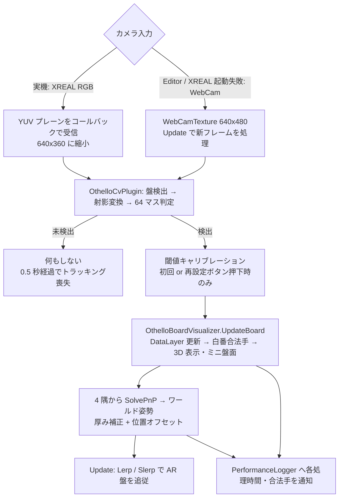

# OthelloAutoTrackerScene 技術仕様書
**プロジェクト名**: AROthelloMaster (XREAL One Pro グラス + XREAL Beam Pro)
**対象シーン**: `Assets/Othello/Scenes/OthelloAutoTrackerScene.unity`
**改訂日**: 2026年11月26日
**バージョン**: 2.0.0（旧版「盤面判定基準フィードバックにおける統計学的アプローチ 技術仕様書 v1.0.0」を本シーンの範囲に再構成）

---

## 1. 概要

### 1.1 目的
グラス搭載の RGB カメラで実物のオセロ盤を認識し、次の 3 つをリアルタイムに行う。
1. 盤面 64 マスの石（黒・白・なし）を判定する。
2. 盤の 3D 位置・姿勢を推定し、AR の盤（ワイヤーフレーム）を実物に重ねる。
3. 白番の合法手を AR 上と手元画面にハイライト表示する。

### 1.2 範囲
本書の対象は `OthelloAutoTrackerScene.unity` に配置されたオブジェクトと、そこから呼ばれるスクリプト・ネイティブプラグインに限る。対象外のものは [12 章](#12-本書の対象外) に挙げる。

### 1.3 動作環境
| 項目 | 内容 |
| :--- | :--- |
| Unity | 6000.3.19f1 / URP 17.3.0 |
| XR | AR Foundation 6.3.5、XR Interaction Toolkit 3.3.2、XREAL XR Plugin（`com.xreal.xr`、ローカルパッケージ） |
| 実機 | XREAL One Pro グラス + XREAL Beam Pro（Android、ARM64、API Level 29 以上） |
| ネイティブ | `libOthelloCvPlugin.so`（`NativePlugin/OthelloCvPlugin.cpp`、OpenCV for Android） |

### 1.4 ビルド
- メニュー **Build > Build Android (Othello Auto Tracker)**（`BuildScript.BuildAndroidAutoTracker`）でビルドする。
- 出力先は `Builds/Android/AROthelloMaster-AutoTracker.apk`。
- ビルドは最初に `CreateOthelloAutoTrackerScene.GenerateScene()` を呼び、**シーンを作り直してから**ビルドする（[11 章](#11-既知の制約と注意点) 参照）。
- ビルド時に設定される項目: IL2CPP、ARM64、OpenGLES3、XREAL `SupportMultiResume = true`（グラスと Beam Pro の 2 画面を別々に表示）、`StereoRendering = MultiPass`、`CAMERA` 権限、XR Management の自動初期化。
- `EditorBuildSettings` に登録されているシーンは本シーンのみ。

---

## 2. シーン構成

### 2.1 階層
```
Directional Light                  [Light]
XR Origin (XR Rig)                 [XROrigin]  (TrackingOriginMode: Device, CameraYOffset 1.1176)
└ Camera Offset
  └ Main Camera                    [Camera, XREALCameraPoseTracker]
    └ Glasses_Visualizer           (Layer: GlassesVisualizer) グラスの形をしたモデル・軸・視線コーン
Overhead_Camera                    [Camera]  → RT_OverheadView (512x512)
Overhead_Reference_Grid            (Layer: GlassesVisualizer) 床グリッド・ワールド軸
EventSystem                        [EventSystem, StandaloneInputModule]
OthelloLogic                       [OthelloLogic]
OthelloBoard_AR_Target             [MeshRenderer(Cube), OthelloBoardVisualizer]
└ ForwardIndicator                 盤の奥方向を示すバー
CustomScreenLogger                 [CustomScreenLogger]
OthelloAR_AutoTracker              [OthelloAutoTracker, PerformanceLogger]
Canvas_AR_Debug                    [Canvas: Screen Space - Camera (Main Camera, 距離 1m)]
├ Preview_Panel_Glasses / RawImage_DebugPreview
└ Log_Panel_Glasses / Text_GlassesLog
Canvas_BeamPro_Handheld            [Canvas: Screen Space - Overlay]
├ Header_Panel_Handheld / Text_Title
├ Preview_Panel_Handheld / RawImage_HandheldPreview
├ Overhead_Panel_Handheld / RawImage_OverheadView
├ Log_Panel_Handheld / Text_HandheldLog
├ Offset_Panel_Handheld            位置オフセット調整 UI
├ MiniBoard_Panel_Handheld / RawImage_MiniBoard, Text_MiniBoardStatus
└ ActionBar_Handheld               軸反転・再設定・ログ記録ボタン
```

### 2.2 主要オブジェクトの役割
| オブジェクト | 役割 |
| :--- | :--- |
| `Main Camera` | グラスの視点。背景は黒（透過表示）、FOV 60、Near 0.05m。`XREALCameraPoseTracker` が頭の姿勢をそのまま反映する。 |
| `OthelloBoard_AR_Target` | AR の盤。Scale が (0.228, 0.018, 0.228) なので、子オブジェクトは [-0.5, +0.5] の正規化座標で配置する。初期位置はカメラ前方 0.6m。 |
| `OthelloAR_AutoTracker` | 認識・姿勢推定・UI 制御を行う中核コンポーネントと、性能ログ記録を持つ。 |
| `Overhead_Camera` | 斜め上から俯瞰した確認用の映像を `RT_OverheadView` に描き、Beam Pro 画面に出す。`GlassesVisualizer` レイヤーを描くのはこのカメラだけ。 |
| `Glasses_Visualizer` / `Overhead_Reference_Grid` | 俯瞰映像でグラスの位置と向き、床のスケールを確認するためのもの。グラス側では表示しない（起動時に他のカメラの CullingMask から外す）。 |

---

## 3. 処理フロー



---

## 4. OthelloAutoTracker（`Assets/Othello/Scripts/OthelloAutoTracker.cs`）

### 4.1 シーン上の設定値
| フィールド | 値 | 説明 |
| :--- | :--- | :--- |
| `targetBoardTransform` | OthelloBoard_AR_Target | 追従させる AR の盤 |
| `trackingCamera` | Main Camera | 姿勢計算の基準カメラ |
| `previewRawImage` / `handheldPreviewRawImage` | RawImage_DebugPreview / RawImage_HandheldPreview | 認識結果を描いた画像の表示先 |
| `boardVisualizer` | OthelloBoard_AR_Target | 表示担当 |
| `webcamDeviceIndex` / `requestedResolution` | 0 / 640x480 | WebCam を使うときの設定 |
| `boardWidthMeters` / `boardDepthMeters` / `boardThicknessMeters` | 0.228 / 0.228 / 0.018 | 実物の盤の寸法 (m) |
| `positionLerpSpeed` / `rotationSlerpSpeed` | 12 / 12 | 追従の滑らかさ（係数 = `Time.deltaTime × 12`） |
| `trackingLostTimeout` | 0.5 秒 | この時間検出が途切れるとトラッキング喪失 |
| `customFx` / `customFy` | 0 | 0 のときはカメラの内部パラメータを自動で決める |
| `invertLocalY` / `invertLocalRotX` / `invertLocalRotZ` / `invertLocalRotY` | true / true / true / false | 軸反転の初期値（実行中に UI で切り替え可） |
| `statusLogInterval` | 0.5 秒 | 状態ログを出す間隔 |

`Awake` で `NativeOthelloRecognizer` を次の設定で作る: `WarpSize = 400`、`MinAreaThreshold = 4000`、`BlackThreshold = 65`、`WhiteThreshold = 165`、`TransparentBackground = false`（認識結果の画像にカメラ映像を背景として描く）。

### 4.2 カメラ入力
1. **実機**: `Start` で 6DoF モードへの切り替えを要求し（`XREALPlugin.SwitchTrackingTypeAsync(MODE_6DOF)`）、続けて `XREALRGBCameraTexture` のキャプチャを始める。失敗したら 1 秒ごとに最大 5 回やり直す。フレームは `OnNativeCameraPlanesAvailable` コールバックで YUV プレーンとして受け取り、640x360 で処理する。
2. **XREAL カメラが使えないとき（Editor を含む）**: `WebCamTexture` を使い、`Update` で新しいフレームが来たときだけ処理する。XREAL カメラがあとから起動できた場合は WebCam を止める。

### 4.3 カメラ内部パラメータ
次の優先順で決める。
1. Inspector の `customFx`・`customFy` が 0 より大きければその値を使う（主点は画像中心）。
2. XREAL から取得した RGB カメラの焦点距離・主点を、処理解像度に合わせて縮小した値。
3. 垂直 FOV からの推定（XREAL カメラは 35.5°、WebCam は 55°。主点は画像中心）。

頭の中心から RGB カメラまでの位置・向きのずれは `XREALPlugin.GetDevicePoseFromHead` で取得する。取得できない場合は (0, 0.02, 0.03) m を使う。

### 4.4 姿勢推定と座標変換
1. **盤の 3D 座標**（盤中心が原点、右手系）: 0 左奥 (-0.114, +0.114, 0)、1 右奥 (+0.114, +0.114, 0)、2 右手前 (+0.114, -0.114, 0)、3 左手前 (-0.114, -0.114, 0)。+X が右、+Y が奥、+Z が盤面の法線。
2. **PnP**: 実機ではネイティブの `OthelloCv_SolvePnP`（まず `SOLVEPNP_IPPE_SQUARE`、失敗したら `SOLVEPNP_ITERATIVE`）を使う。使えない場合は C# の平面ホモグラフィ分解（DLT で 8x8 の連立方程式を解き、Gram-Schmidt で直交化）で代わりに解く。
3. **妥当性チェック**: カメラから盤までの奥行きが 0.05m 以下、または 5.0m を超える場合は結果を捨てる。
4. **OpenCV（Y が下向き）から Unity カメラ座標へ**: 位置は `(tx, invertLocalY ? ty : -ty, tz)`。回転は回転行列の列ベクトルの Y 成分を反転して `LookRotation(盤の奥方向, 盤の法線)` を作る。さらに `invertLocalRot*` が true の軸は、クォータニオンの対応する成分の符号を反転する。
5. **ワールド座標へ**: RGB カメラ → 頭の中心（4.3 のずれ）→ `Main Camera` の Transform の順に変換する。
6. **厚み補正**: 認識できるのは盤の天面なので、法線と逆向きに厚みの半分（0.009m）ずらし、AR の盤の中心に合わせる。
7. **位置オフセット補正**: 4.6 の値を加える。
8. **追従**: 初めて検出したときは目標位置へすぐ移す。以降は `Update` で `Lerp`・`Slerp` を使って目標位置へ近づける。トラッキングを失ったあとは最後の位置にとどまる（非表示にはしない）。

### 4.5 閾値キャリブレーションを行うタイミング
- **起動後の最初の検出時**（`_hasAutoCalibrated`）と、**再設定ボタンの押下後に最初に検出したとき**（`Btn_Recalibrate` → `RequestRecalibration()` → `_recalibrateRequested`）に `CalibrateDynamicThresholds()` を実行する。
- 結果は画面ログと `OthelloBoardVisualizer.CalibrationStatusText` に出す（ミニ盤面の下に `B<xx | W>yy (η:0.xx)` と表示）。
- 新しい閾値が使われるのは**次のフレームの判定から**。キャリブレーションを行ったフレーム自体は古い閾値で判定済み。

### 4.6 位置オフセット補正（±6cm）
座標系を 3 種類から選び、それぞれ X/Y/Z を -6.0〜+6.0 cm の範囲で調整できる。値はモードごとに別々に保存する。
| モード | X | Y | Z |
| :--- | :--- | :--- | :--- |
| `ViewHorizontal`（初期値） | 視線の左右（水平面に投影） | 鉛直方向 | 視線の前後（水平面に投影） |
| `BoardLocal` | 盤の左右 | 盤の法線 | 盤の奥・手前 |
| `WorldAbsolute` | ワールド X | ワールド Y | ワールド Z |

- **Quick -3cm**: 今のモードの Z を -0.03m にする（盤が奥に約 3cm ずれる問題への対処）。
- **Reset**: 今のモードの値を 0 に戻す。
- 値は PlayerPrefs に保存し、次回起動時に読み込む（[9 章](#9-永続化データplayerprefs) 参照）。

### 4.7 状態ログ
0.5 秒ごとに画面ログへ次の内容を出す。
- トラッキング中: `[BOARD]` 盤の位置・回転・カメラからの距離、`[HEAD]` 頭の位置・回転、FPS、軸反転の状態。
- 盤を探しているとき: `[SEARCH]` FPS と頭の姿勢。

---

## 5. 盤面認識（`NativeOthelloRecognizer.cs` / `NativePlugin/OthelloCvPlugin.cpp`）

### 5.1 盤検出（`ProcessBgrImage`）
1. BGR を HSV に変換し、緑のフェルトを `inRange(H 35–85, S 50–255, V 50–255)` で取り出す。5x5 のクロージングで隙間を埋める。
2. 外側の輪郭を抽出し、`approxPolyDP`（周長の 3%）で 4 頂点の凸多角形に近似できるもののうち、面積が `MinAreaThreshold`（4000 px²）を超えて最大のものを盤とみなす。
3. 4 隅を「x+y が最小 = 左上、最大 = 右下、残り 2 点は x−y で左右を分ける」規則で並べ、400x400 px に射影変換する。
4. 1 マス 50px の中央 26x26 px（外周 12px を除く）の平均値から、各マスの次の値を求める。
   - **輝度** = BGR 3 チャンネルの平均（HSV の V ではない）
   - **彩度 S**（0–255）、**色相 H**（0–180）
5. `輝度 < BlackThreshold` なら黒、`輝度 > WhiteThreshold` なら白、それ以外は石なし。
6. 64 マスの統計値はプラグイン内に保存し、`OthelloCv_GetLastCellStats` で取り出せる。

### 5.2 認識結果の画像
- 検出できたとき: カメラ映像に、盤の輪郭（黄、太さ 4）と判定した石（黒・白の円 + 緑の縁）を重ねる。
- 検出できないとき: Canny エッジ（シアン）と緑領域の輪郭を重ねる。
- YUV 入力のときは左上に緑の点を描き、OpenCV が動いていることを示す。
- 結果の画像は `RawImage_DebugPreview`（グラス）と `RawImage_HandheldPreview`（Beam Pro）に表示する。

### 5.3 出力
- 盤面は `DiscColor[8, 8]`（`[行, 列]`、`None = 0, Black = 1, White = 2`）。行 0 が奥、列 0 が左。
- 4 隅は `Vector2[4]` の画像座標（0 左上、1 右上、2 右下、3 左下）。

---

## 6. 閾値の自動調整（Multi-Otsu）

### 6.1 背景
固定の閾値（黒 < 65、白 > 165）では、暗い部屋で白石を、明るい部屋で黒石を見落とす。盤面ではフェルトが 50〜60 マスを占め石は数個しかない（クラス不均衡）ため、全体の平均やパーセンタイルを基準にする方法も使えない。そこで 64 マスの輝度を黒石 $C_0$・フェルト $C_1$・白石 $C_2$ の 3 クラスに統計的に分ける。

### 6.2 アルゴリズム（`CalibrateMultiOtsu`）
入力: 64 マスの輝度 $v_i$（0–255）と彩度 $s_i$。

1. **全体の統計量**: 平均 $\mu_T$、分散 $\sigma_T^2$。
2. **ヒストグラムと累積表**: $h(v)$、累積度数 $P[v]$、累積一次モーメント $M[v]$。
3. **クラス間分散が最大になる境界を全探索**（$5 \le t_1 \le 245$, $t_1+6 \le t_2 \le 250$、約 2.9 万通り）:
$$\sigma_B^2 = \sum_{k=0}^{2} \omega_k(\mu_k - \mu_T)^2, \quad (t_1^*, t_2^*) = \arg\max \sigma_B^2$$
4. **分離度**: $\eta = \sigma_B^2 / \sigma_T^2$（0〜1 に収める）。
5. **フェルトの統計量**: 彩度が $S \ge 35$ のマス、または $t_1^* < v < t_2^*$ のマスから平均 $\mu_f$ と標準偏差 $\sigma_f$ を求める。
6. **退化判定**:
$$\text{IsDegenerate} \iff (\eta < 0.60) \lor (\mu_2^* - \mu_0^* < 45) \lor (\sigma_T^2 < 120)$$
7. **境界の決定**
   - **退化している場合（石がほとんどない盤）**: フェルトの正規分布の ±3.5σ を境界にする。片側で外れる確率は約 0.023%。
   $$t_b = \text{clamp}(\text{round}(\mu_f - 3.5\sigma_f), 20, 95), \quad t_w = \text{clamp}(\text{round}(\mu_f + 3.5\sigma_f), 135, 235)$$
   - **3 クラスに分かれている場合**: 大津法の境界をそのまま使わず、各クラスの平均の中点を使う（数の偏りで境界が外側に寄るのを防ぐ）。さらにフェルトのばらつきに応じた範囲に収める。
   $$t_b = \text{clamp}\big(\text{round}(\tfrac{\mu_0^*+\mu_1^*}{2}),\ \max(12, \mu_f-3.2\sigma_f),\ \max(15, \mu_f-1.5\sigma_f)\big)$$
   $$t_w = \text{clamp}\big(\text{round}(\tfrac{\mu_1^*+\mu_2^*}{2}),\ \min(235, \mu_f+1.5\sigma_f),\ \min(242, \mu_f+3.2\sigma_f)\big)$$
8. 結果（`CalibrationResult`）を `BlackThreshold`・`WhiteThreshold` に反映し、`LastCalibration` に保存する。

統計値をまだ取得できていないとき（認識に一度も成功していない）は、閾値を変えずに `IsDegenerate = true` を返す。

### 6.3 参考: 仮想データでの検証結果
`Assets/Editor/ThresholdClusteringExperimentReport.txt`（Editor 用テストの出力）より。
| ケース | フェルト輝度 | 黒/白の石数 | 算出した境界 | η | 判定 | 正解率（固定閾値のとき） |
| :--- | :--- | :--- | :--- | :--- | :--- | :--- |
| 1. 通常 | 110±7 | 2 / 2 | B<92, W>130 | 0.943 | 3 クラス | 100%（100%） |
| 2. 薄暗い | 52±5 | 8 / 6 | B<32, W>79 | 0.965 | 3 クラス | 100%（12.5%） |
| 3. 明るすぎる | 170±8 | 10 / 14 | B<147, W>196 | 0.983 | 3 クラス | 100%（39.1%） |
| 4. 暖色照明 | 132±8 | 5 / 5 | B<110, W>156 | 0.971 | 3 クラス | 100%（100%） |
| 5. 寒色照明 | 88±6 | 7 / 9 | B<53, W>132 | 0.988 | 3 クラス | 100%（100%） |
| 6. 石なし | 112±7 | 0 / 0 | B<93, W>135 | 0.828 | 退化（±3.5σ） | 100%（100%） |

- ケース 6 は η が 0.60 以上だが、全体の分散が小さいため退化と判定される。
- ケース 1 では中点（黒 68 / 白 168）がクリップ範囲の端（$\mu_f \mp 3.2\sigma_f$ = 92 / 130）まで寄せられている。石とフェルトの輝度差が大きいときは、ほとんどこの端で境界が決まる。

---

## 7. 表示と盤面ロジック

### 7.1 OthelloBoardVisualizer（`OthelloBoard_AR_Target` に付いている）
**初期化**: 親の Cube 自体のレンダラーは無効にし、子オブジェクトを生成する。
| 生成物 | 内容 |
| :--- | :--- |
| `GridLines_Container` | 天面の格子線（縦横 9 本ずつ。太さは外周 0.012、内側 0.005）、底面の 4 辺、4 隅の柱。マテリアルは外周・柱・底面に `customBoardMaterial`、内側の線に `customBoardInnerMaterial`（未設定なら外周用を使う）。 |
| `Cells_Container` | 64 マス分の白石・黒石のドット（直径約 1.6mm の球、高さ y = 0.53）。普段は非表示。黒石はシアンで表示する。 |
| `Highlights_Container` | 64 マス分の合法手ハイライト（黄色の円柱、直径約 1.4cm、y = 0.54）。表示中は `1 + 0.16·sin(6t)` の倍率で脈打つ。 |

マス (行 r, 列 c) の位置は、正規化座標で $x = -0.5 + (c+0.5)/8$、$z = +0.5 - (r+0.5)/8$。

**`UpdateBoard(DiscColor[,])`**（検出したフレームごとに呼ばれる）
1. `DataLayer.StoneData[列][行]` に、黒 = -1、白 = 1、空 = 0 として書き込む。
2. `OthelloLogic.playableStonePositions(targetTeam)` で合法手を求める（`targetTeam = 1`、**白番で固定**。手番の管理はしない）。処理時間を計測する。
3. 3D のドットとハイライトの表示を切り替える（空マスの合法手だけハイライトする）。
4. 128x128 のミニ盤面テクスチャ（1 マス 16px）を描き直す。白石は白丸、黒石は黒丸にシアンの縁、合法手は黄色の点と輪。
5. `Text_MiniBoardStatus` に `B:n W:n | Legal (WHITE): n` とキャリブレーション結果を表示する。
6. 合法手を 64bit のビットマスクにして `PerformanceLogger` に渡す。

マテリアルはシーンで割り当て済み（`customBoardInnerMaterial` だけ未設定）。未設定のものは実行時に URP/Unlit で作る。

### 7.2 OthelloLogic / DataLayer
- `DataLayer.StoneData` は static の `int[8][8]`（`[x=列][z=行]`、-1 黒 / 0 空 / 1 白）。シーンにコンポーネントとしては置かれていない。初期値はサンプル配置で、最初の `UpdateBoard` で上書きされる。
- `OthelloLogic` はシングルトン（`Awake` で `Instance` を設定）。
  - `playableStonePositions(team)`: 空マスのうち `isPlayableStone` が true のマスの一覧（`Vector2Int(x=列, y=行)`）を返す。
  - `isPlayableStone(team, x, z)`: 8 方向それぞれについて、隣が相手の石で、その先に空マスを挟まず自分の石があれば true。

### 7.3 XREALCameraPoseTracker（`Main Camera` に付いている）
- XR の `CenterEye` → `Head` → HeadMounted 特性を持つデバイス、の順に頭部デバイスを探す。見つからなければ 1 秒ごとに探し直す。
- 毎フレーム `deviceRotation` を `localRotation` に、`devicePosition` を `localPosition` にそのまま入れる（`trackRotation`・`trackPosition`・`fallbackTo3DoF` はすべて true）。
- 実機では `Start` で 6DoF への切り替えを要求する。

---

## 8. UI

### 8.1 グラス側（`Canvas_AR_Debug`、Screen Space - Camera、距離 1m）
| 要素 | 内容 |
| :--- | :--- |
| `RawImage_DebugPreview` | 認識結果の画像 |
| `Text_GlassesLog` | 画面ログ（最新 20 行） |

### 8.2 Beam Pro 側（`Canvas_BeamPro_Handheld`、Screen Space - Overlay）
| 要素 | 内容 |
| :--- | :--- |
| `RawImage_HandheldPreview` | 認識結果の画像 |
| `RawImage_OverheadView` | 俯瞰カメラの映像（`RT_OverheadView`） |
| `Text_HandheldLog` | 画面ログ（グラス側と同じ内容） |
| `RawImage_MiniBoard` / `Text_MiniBoardStatus` | 2D のミニ盤面、石数、合法手数、キャリブレーション結果 |
| `Offset_Panel_Handheld` | 位置オフセットの調整（4.6） |
| `ActionBar_Handheld` | 下表のボタン |

**ボタンとスライダー**: どれも実行時に `GameObject.Find(名前)` で探してイベントを登録する（シーン上にイベント登録はない）。
| 名前 | 動作 | 登録元 |
| :--- | :--- | :--- |
| `Btn_Toggle_YPos` / `Btn_Toggle_RotX` / `Btn_Toggle_RotZ` / `Btn_Toggle_RotY` | 軸反転の切り替え。ラベルは `INV` / `NORM`、反転中は緑 | OthelloAutoTracker |
| `Btn_Recalibrate` | 閾値の再キャリブレーションを予約する | OthelloAutoTracker |
| `Btn_OffsetMode_Horiz` / `_Board` / `_World` | オフセットの座標系を切り替える（選択中のボタンが色付きになる） | OthelloAutoTracker |
| `Btn_Offset_Quick3cm` / `Btn_Offset_Reset` | Z を -3cm にする / 今のモードの値を 0 に戻す | OthelloAutoTracker |
| `Slider_Offset_X` / `_Y` / `_Z` | -6〜+6 cm（ラベルは `Text_Offset_X/Y/Z`） | OthelloAutoTracker |
| `Btn_Toggle_PerfLog` | 性能ログの記録を開始・停止して保存する（Editor では Space キーでも可） | PerformanceLogger |

### 8.3 画面ログ（CustomScreenLogger）
- シングルトン。`Log`・`LogWarning`・`LogError` と、`Application.logMessageReceivedThreaded` で受け取った Unity のログを、最大 20 行のリングバッファに溜める。
- 各行は `[LOG]`・`[WARN]`・`[ERR]` と時刻 `HH:mm:ss` を付けて色分けし、`Text_GlassesLog` と `Text_HandheldLog` の両方に表示する。

### 8.4 性能ログ（PerformanceLogger）
記録中は毎フレーム 1 行をメモリに溜め、停止時（アプリの一時停止・終了時も）に CSV として保存する。
- **保存先**: 実機は `Application.persistentDataPath`、Editor は `<プロジェクト>/Exports`。ファイル名は `performance_log_yyyyMMdd_HHmmss.csv`、文字コードは UTF-8。
- **列（13 項目）**: `Timestamp`（UTC）, `FrameCount`, `CurrentFPS`（直近 1 秒の平均）, `Latency_Total_ms`, `Latency_Capture_ms`, `Latency_Recognition_ms`, `Latency_Algorithm_ms`（合法手計算）, `Latency_Render_ms`（3D 表示とミニ盤面）, `Head_Distance_cm`（カメラと盤の距離）, `Head_Angle_deg`（盤の法線とカメラ方向のなす角）, `Tracking_Offset_mm`（今のオフセットの大きさ）, `Move_Flicker_Count_1s`（直近 1 秒で合法手が変わった回数）, `Algorithm_Accuracy_Flag`（目視で手入力する欄。常に空）。

---

## 9. 永続化データ（PlayerPrefs）
| キー | 内容 |
| :--- | :--- |
| `OthelloAR_OffsetMode` | オフセットの座標系（0 = 水平視線、1 = 盤、2 = ワールド） |
| `OthelloAR_HorizOffset_X/Y/Z` | 水平視線系のオフセット (m) |
| `OthelloAR_BoardOffset_X/Y/Z` | 盤ローカル系のオフセット (m) |
| `OthelloAR_WorldOffset_X/Y/Z` | ワールド系のオフセット (m) |

軸反転と閾値は保存しない（起動のたびに初期値に戻る）。

---

## 10. Editor で実行したときの動き
- WebCam がなければフレームは処理されない（盤の検出・表示の更新は起きない）。AR の盤はカメラ前方 0.6m に置かれたまま。
- WebCam があれば、映像の中身に関係なく、**決められた盤面**（初期配置の 4 石 + 黒 (2,3)、白 (5,4)）と画像の 15% 内側の 4 隅を返す。姿勢は C# の PnP で計算される。
- キャリブレーションには、フェルト 110±8 に初期配置の 4 石を置いた乱数データを使う。
- XREAL 関連の API（6DoF 切り替え、RGB カメラ、内部パラメータ）は呼ばれない。

---

## 11. 既知の制約と注意点
1. **ビルドでシーンが作り直される**: Build > Build Android (Othello Auto Tracker) は `OthelloARDebugSetup.SetupScene()` でシーンを生成し直してから保存する。シーンを手で直した内容は消えるので、変更は生成スクリプトに入れる必要がある。
2. **UI は名前で探している**: ボタン・スライダー・ラベルは `GameObject.Find` で探すので、名前を変えると動かなくなる。
3. **閾値が使われるのは次のフレームから**: キャリブレーションを行ったフレームの盤面は古い閾値で判定されている。
4. **「輝度」は RGB の平均**: 旧版の仕様書は HSV の V（明度）と書いていたが、実装は BGR 3 チャンネルの平均で、判定もキャリブレーションもこの値を使う。
5. **合法手は白番だけ**: 手番や石を返す処理はなく、表示しているのは常に「今の盤面で白が置けるマス」。
6. **トラッキング喪失時**: AR の盤と石の表示は最後に検出した状態のまま残る。
7. **6DoF 切り替えを 2 か所で要求している**: `OthelloAutoTracker` と `XREALCameraPoseTracker` の両方が `SwitchTrackingTypeAsync(MODE_6DOF)` を呼ぶ。
8. **閾値の範囲が狭い**: 3 クラスに分かれている場合でも境界はフェルトの $\mu_f \mp 3.2\sigma_f$〜$\mu_f \mp 1.5\sigma_f$ に制限されるので、6.3 のとおり実際にはほとんどこの端で決まる。

---

## 12. 本書の対象外
本シーンに含まれない次のものは扱わない。
- 他のシーン（`ARBoardTestScene`、`Othello3DARScene`、`SampleScene`、`SimpleARScene`、OpenCV デモシーン）とその専用スクリプト（`AROthelloBoardTestController`、`AndroidOpenCvDemoController`、`SimpleARDiagnostics`、`Simulator_manager` など）
- Editor 用のテスト・シーン生成ツール（`TestThresholdClustering`、`Create*Scene`、`OthelloARDebugSetup` の中身）。ビルドの流れとの関係は 1.4 と 11 章でのみ触れる。
- 今後の拡張案（彩度を加えた 2 次元クラスタリング、時系列平滑化など）
